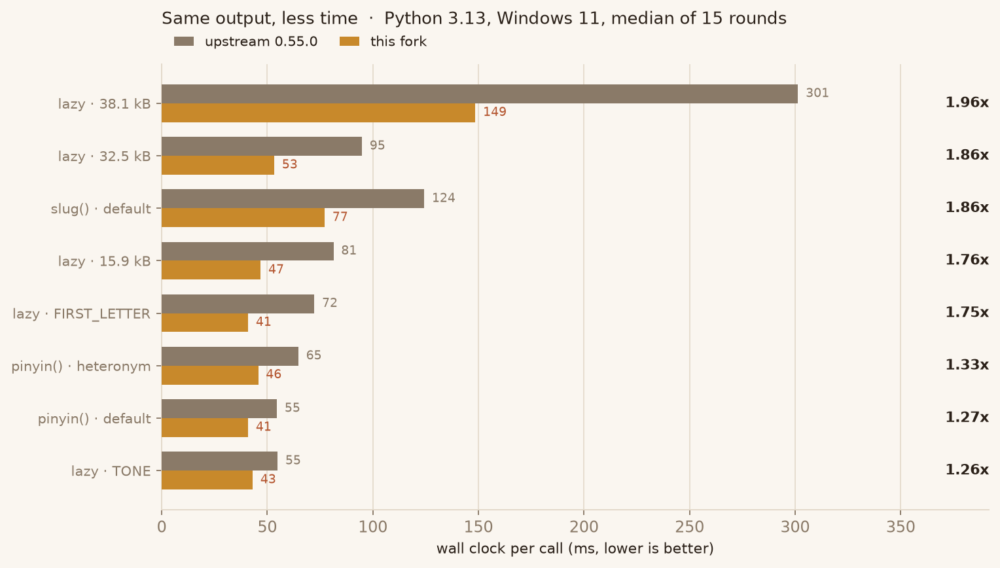
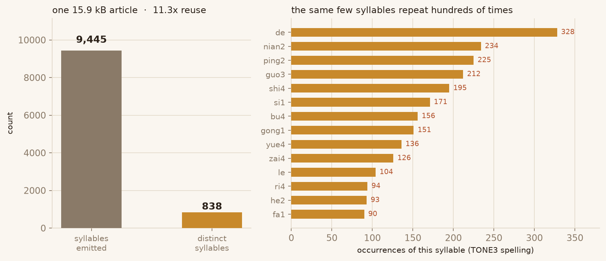
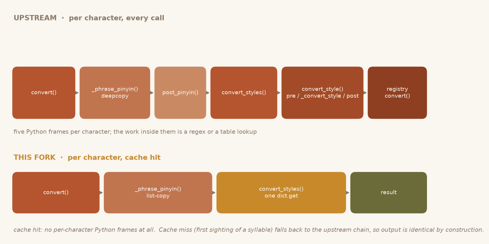
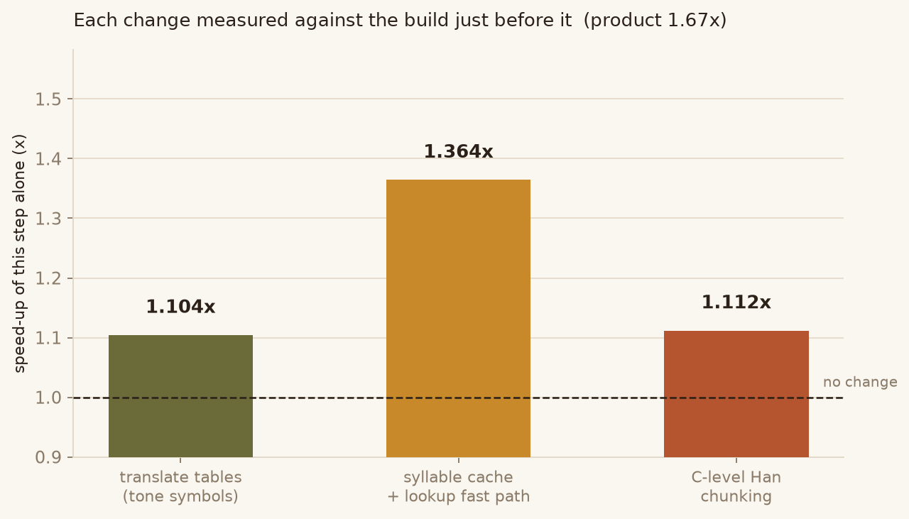

# pypinyin-opt-lab

An optimised fork of [`mozillazg/python-pinyin`](https://github.com/mozillazg/python-pinyin)
— the Chinese-character → pinyin converter. Same public API, byte-identical
output on every test, **1.3x–2.5x faster** depending on the workload
(median **1.70x** across all workloads, **1.71x** on long text).



| | |
|---|---|
| Upstream | [mozillazg/python-pinyin](https://github.com/mozillazg/python-pinyin) @ `8595294`, v0.55.0 |
| Licence | MIT, Copyright (c) 2016 mozillazg, 闲耘 — see `LICENSE.txt` |
| This fork | MIT, original copyright retained |
| What changed | 3 changes, each marked `[OPT]` in the source — see `NOTICE.md` |
| Verified | 966 tests pass; 12 new differential tests compare every character, every phrase, and 3 corpora across all 18 styles |

---

## 1. Why this library is worth optimising

`pypinyin` is not a toy: it sits in the hot path of search indexing, sorting,
slug generation and TTS preprocessing. And it has a property that makes it a
good optimisation target — **it is a pure function of the text**, so any
speed-up can be proven safe by comparing outputs, not by arguing about
semantics.

Profiling `lazy_pinyin()` on a 15.9 kB article (9.1 k Han characters) showed
where the 55 ms goes:

| Stage | Share | What it does |
|---|---|---|
| `convert_styles` → `convert_style` → `_convert_style` → registry | **69 %** | five Python frames per character |
| `_phrase_pinyin` → `deepcopy` | 17 % | deep-copies a 1–4 element nested list per word |
| segmentation (`mmseg.cut`) | 12 % | maximal forward matching |
| tone-symbol conversion (regex + 4 × `str.replace`) | 8 % | runs once per character |

The first row is the interesting one. It is **pure architectural overhead**:
the work inside those frames is a regex or a dictionary lookup, but reaching
it costs five function calls. No amount of tuning inside the callee helps.

## 2. The observation that unlocks it



A 15.9 kB article emits **9 445 syllables but only uses 838 distinct ones** —
an 11.3x reuse ratio. `de`, `shi4`, `guo3` each appear 200–330 times. Since
style conversion is a pure function of `(syllable, style, strict, config)`,
those 8 600+ repeat computations are pure waste.



So the fork puts a cache where the chain is *entered*, not where it ends: one
`dict` lookup replaces the whole five-frame walk.

## 3. The three changes



Each bar is measured **against the build immediately before it**, so the
numbers multiply out to the total (1.104 × 1.364 × 1.112 = 1.67x, matching the
end-to-end 1.71x on the same corpus within run-to-run noise). See
`bench/ablation.py`.

### 3.1 Tone symbols: one `translate` instead of a regex plus four replaces

`replace_symbol_to_number()` used to run `re.sub` with a per-character callback,
then four `str.replace` calls for the multi-codepoint symbols (`m̄`, `m̀`, `ê̄`,
`ê̌`). Every one of those single-character mappings is a plain 1:1 table, so the
whole thing collapses into one C-level `str.translate`:

```python
_NUMBER_TABLE = {ord(sym): to for sym, to in PHONETIC_SYMBOL_DICT.items()
                 if len(sym) == 1}
value = pinyin.translate(_NUMBER_TABLE)     # 0.85 µs → 0.05 µs per syllable
```

The table is **derived from `PHONETIC_SYMBOL_DICT`**, not hand-written, so it
cannot drift when the dictionary changes. The four multi-codepoint symbols keep
the `str.replace` path (guarded by an `in` test), because a combining mark
cannot be expressed as a per-character mapping.

`replace_symbol_to_no_symbol()` gets the same treatment, with digits mapped to
`''` — folding the old `RE_NUMBER.sub()` into the same pass.

### 3.2 Syllable-level conversion cache with an explicit safety contract

This is the big one, and the only one with real risk: caching a function that
*looks* pure but reads `han` would silently corrupt output. So the cache is
guarded by three independent conditions, all structural:

**Condition 1 — the style implementation is declared pure.**

`register()` gained a `pure` flag. All 18 built-in styles pass `pure=True`
(verified individually: none of them reads `han`). Anything a user registers
defaults to `pure=False` and is therefore never cached. A user style that
returns `kwargs['han'] + pinyin` — exactly the case in the upstream test suite
— keeps working because it never enters the cache.

> A first attempt inferred purity by diffing the registry before and after
> `auto_discover()`. It **silently mislabelled `TONE`/`TONE2`/`TONE3`**,
> because `pypinyin.style.tone` is imported earlier by another module and so
> was already in the registry when the diff ran. The cache appeared to work
> (results were still correct) but those three styles never got faster.
> Explicit declaration has no such blind spot, and
> `test_style_registry_pure_flags` now fails loudly if a style is left
> unmarked.

**Condition 2 — the conversion chain has not been overridden.**

The fast path resolves `convert_style`, `pre_convert_style`,
`post_convert_style` and `post_pinyin` by name and compares the resulting
function objects against a whitelist. Any user subclass that overrides one of
them falls back to the upstream per-character loop. Identity, not class name —
`class My(UltimateConverter)` with its own `post_pinyin` is a different
algorithm and must not inherit the assumption.

The result is memoised per class: without that, four MRO lookups per call cost
12 % of total runtime (measured).

**Condition 3 — the style registry has not changed.**

Every `register()` bumps a generation counter; the cache checks it and flushes
itself when it moves. Without this, re-registering `Style.NORMAL` would keep
serving results computed by the *old* implementation.

The key is `(style, strict, v_to_u, neutral_tone_with_five, tone_sandhi)`.
The three mixin switches change per-character output but never read `han`, so
they belong in the key — otherwise `v_to_u=True` followed by `False` would read
a poisoned bucket. The cache holds at most 200 000 entries and clears itself
when full, so a huge custom dictionary cannot blow up memory.

### 3.3 Han/non-Han chunking in C instead of per character

`simple_seg._seg()` classified **every character** with `RE_HANS.match()` and
stitched runs together in Python: 1.07 ms for a 5 000-character text. `RE_HANS`
is an anchored whole-string match (`^[...]+$`), which is why it could not be
used for splitting. Deriving an unanchored sibling from the *same* character
class turns the loop into one `findall`:

```python
_HANS_CLASS = RE_HANS.pattern[len('^(?:['):-len('])+$')]   # same class, no anchors
RE_HANS_CHUNKS = re.compile('[{0}]+|[^{0}]+'.format(_HANS_CLASS))
```

0.13 ms — 8x faster. The character class is **sliced out of `RE_HANS.pattern`**
rather than retyped, so a future Unicode-range update upstream is picked up
automatically; if the pattern shape ever changes, `_derive_chunk_pattern()`
returns `None` and the code falls back to the per-character loop.

One behavioural detail this surfaced: upstream returns `['']` for an empty
string (the loop never runs, the trailing `append` fires), while `findall`
returns `[]`. That difference propagates through `chain()` to callers, so it is
reproduced explicitly.

### 3.4 Also: `deepcopy` → list-copy in `_phrase_pinyin`

`convert_styles` only ever **replaces** whole cells (`pinyin_list[idx] = [...]`);
it never mutates an inner list. So the full `deepcopy` of the dictionary entry
can become a one-level copy:

```python
pinyin_list = [item[:] for item in PHRASES_DICT[phrase]]
```

This is defensive rather than load-bearing: even without the inner copy, the
public API cannot leak a mutation into `PHRASES_DICT`, because `convert_styles`
replaces every element. It matters for anyone who overrides `convert_styles`
and mutates in place — `test_phrase_dict_not_mutated` asserts both layers.

## 4. Results

Measured on Windows 11, CPython 3.13.14, AMD laptop CPU. Each case runs in its
own process; the two implementations are timed alternately (A B B A) inside
each round, and the reported figure is the **median of per-round ratios**, not
a ratio of medians.

The whole suite was run **three times**; the table reports the median of the
three and, in brackets, the spread. Ratios are stable to within a few percent
across runs, while absolute times drift by up to 25 % with CPU clock state —
which is exactly why the comparison is paired.

| Workload | upstream | this fork | speed-up (3 runs) |
|---|---:|---:|---:|
| `lazy_pinyin` · 7 chars | 35.7 µs | 15.9 µs | **2.28x** [2.21–2.39] |
| `lazy_pinyin` · 19 chars | 80.6 µs | 37.0 µs | **2.47x** [2.40–2.64] |
| `pinyin(list)` · pre-segmented | 42.4 µs | 26.4 µs | **1.65x** [1.64–1.72] |
| `lazy_pinyin` · 15.9 kB | 81.4 ms | 46.9 ms | **1.71x** [1.64–1.76] |
| `lazy_pinyin` · 32.5 kB | 94.9 ms | 53.3 ms | **1.88x** [1.86–1.93] |
| `lazy_pinyin` · 38.1 kB | 301.4 ms | 148.6 ms | **1.97x** [1.95–1.97] |
| `lazy_pinyin` · `Style.TONE` | 54.9 ms | 43.1 ms | 1.27x [1.19–1.30] |
| `lazy_pinyin` · `FIRST_LETTER` | 72.3 ms | 41.0 ms | 1.69x [1.65–1.75] |
| `pinyin()` · default | 54.6 ms | 41.0 ms | 1.28x [1.18–1.34] |
| `pinyin()` · `heteronym=True` | 64.8 ms | 45.7 ms | 1.36x [1.33–1.45] |
| `slug()` · default | 124.4 ms | 77.2 ms | 1.70x [1.70–1.86] |

Absolute columns are from the same run that produced `assets/fig1_walltime.png`
(and `bench/results.json`), so figure and table agree exactly. They are the
slowest of the three runs — that machine state is worth knowing about, because
absolute times drift by up to 25 % with CPU clock, while the ratios do not.
Short-input absolute times come from a separate tight loop (20 000 iterations
of a single call) because a per-call timer at 20 µs is dominated by
quantisation.

**Noise floor.** Timing a byte-identical copy of upstream against upstream
reports 0.976x–1.021x across the three runs. Anything inside that band is not
an effect.

### Where the gains are smallest, and why

`pinyin()` and `Style.TONE` gain least, and for the same reason: they start
cheap. `TONE`'s conversion function is the identity — it returns the syllable
unchanged — and costs **0.31 µs per call against 0.89 µs for `NORMAL`**. A
cheaper callee means less to remove, so a fixed structural saving lands on a
smaller base. `pinyin()` additionally allocates a fresh `UltimateConverter`
per call, which the cache cannot help with.

This is a ceiling, not a defect: the fork's absolute time for `TONE` (32.8 ms)
is close to its time for `NORMAL` (31.6 ms) even though `TONE` starts 25 %
faster.

### Short inputs gain the most

7-character inputs go from 35.7 µs to 15.9 µs — 2.3x. The fixed cost of the
five-frame chain dominates there, and that is exactly what the cache removes.
This is also the common case in practice: names, single words, table cells.

## 5. Correctness

Output is identical **by construction** for the cached path (a miss runs the
original chain and stores its result), but "by construction" is not evidence.
`tests/test_equivalence.py` imports upstream under a second module name
(`pypinyin_ref`) and diffs:

| Test | Coverage |
|---|---|
| `test_single_chars_all_styles` | all 41 923 dictionary characters × 18 styles × 5 parameter combos — 3.7 M comparisons |
| `test_all_phrases_all_styles` | all 47 111 phrase-dictionary entries × 18 styles |
| `test_corpora_all_styles` | 3 real articles × 18 styles |
| `test_extension_flags` | `v_to_u`, `neutral_tone_with_five`, `tone_sandhi` on/off |
| `test_slug_and_list_input` | `slug()` and pre-segmented list input |
| `test_custom_dict_roundtrip` | `load_phrases_dict` / `load_single_dict` + segmenter retrain |
| `test_random_fuzz` | 60 random strings mixing phrases, characters, punctuation |

Plus structural assertions, because a behaviour diff **cannot** detect a cache
that was silently disabled — the output would still be right, just slower:

- `test_cache_engages_for_pure_style` — the cache is actually populated
- `test_cache_skips_non_pure_style` — a `han`-reading style is never cached
  (same syllable, different characters → different output)
- `test_cache_invalidated_on_reregister` — re-registering a style takes effect
- `test_phrase_dict_not_mutated` — no mutation leaks into `PHRASES_DICT`
- `test_style_registry_pure_flags` — all 18 built-ins marked pure

### Mutation testing

Each assertion was verified by **breaking the code on purpose** and confirming
the test fails:

| Injected bug | Caught by |
|---|---|
| Remove the generation check | `test_cache_invalidated_on_reregister` |
| Cache non-pure styles too | `test_cache_skips_non_pure_style` |
| Stop writing to the cache | `test_cache_engages_for_pure_style` |
| Un-mark one built-in style | `test_style_registry_pure_flags` |
| Share inner lists with `PHRASES_DICT` | `test_phrase_dict_not_mutated` |

Two of these were **not** caught on the first attempt:

1. `test_cache_invalidated_on_reregister` initially registered its replacement
   style *without* `pure=True`. The non-pure path never touches the cache, so
   the test passed for the wrong reason — removing the generation check did not
   make it fail. Fixed by registering with `pure=True`.
2. `test_phrase_dict_not_mutated` only exercised `pinyin()`, which passes
   through `convert_styles`' cell replacement; it passed even with the inner
   copy removed. Fixed by asserting the internal contract of `_phrase_pinyin`
   directly.

A green suite on the first run means the suite is not yet testing the thing
you think it is.

### Upstream test suite

`966 passed, 2 skipped, 10 failed`. The 10 failures are all in `test_cmd.py`
and are **pre-existing on this machine**: they swap `sys.stdout` for a fake
buffer, which trips pytest's capture on Windows. The pristine upstream checkout
fails the same 10, with identical messages.

## 6. Install & use

No API changes — it is a drop-in replacement:

```bash
pip install -e .
```

```python
from pypinyin import lazy_pinyin, pinyin, Style

lazy_pinyin('中心思想')                       # ['zhong', 'xin', 'si', 'xiang']
pinyin('中心', heteronym=True)                # [['zhōng', 'zhòng'], ['xīn']]
lazy_pinyin('战略', v_to_u=True)              # ['zhan', 'lüe']
lazy_pinyin('衣裳', style=Style.TONE3,
            neutral_tone_with_five=True)      # ['yi1', 'shang5']
lazy_pinyin('你好', style=Style.TONE2,
            tone_sandhi=True)                 # ['ni2', 'ha3o']
```

Requires Python 2.7 / 3.5+ (the fork keeps upstream's compatibility floor; it
is only *measured* on 3.13).

### Cache control

```python
from pypinyin.converter import clear_style_cache

clear_style_cache()      # drop cached conversions, e.g. after patching a
                         # converter class at runtime or to reclaim memory
```

Registering a style already invalidates the cache automatically; this is only
needed for out-of-band changes. To opt a custom style into caching, declare it
pure **only if it never reads `han`**:

```python
from pypinyin.style import register

@register('upper', pure=True)          # safe: output depends only on pinyin
def upper(pinyin, **kwargs):
    return pinyin.upper()
```

## 7. Reproducing the numbers

```bash
pip install -e . pytest matplotlib

python -m pytest tests -q                    # 966 pass (10 known test_cmd failures)
python bench/run_bench.py                    # ~2 min, writes bench/results.json
python bench/ablation.py                     # ~1 min, writes bench/ablation.json
python tools/make_figures.py                 # rewrites assets/*.png from the JSON
```

`bench/bench.py` documents the measurement protocol in its module docstring —
one workload per process, ABBA interleaving, ratio-of-rounds rather than
ratio-of-medians, and a noise floor from a byte-identical reference copy.

One environment note worth keeping: this laptop drops to roughly half clock
after ~30 s of sustained load (a fixed pure-Python loop goes from 5.3 ms to
10.1 ms and stays there). A long run therefore mixes two clock regimes and
inflates the spread enormously. The default repeat counts are tuned so each
case finishes inside the fast regime.

## 8. What was tried and rejected

Honest record, because negative results are results:

| Attempt | Outcome |
|---|---|
| Rewrite `mmseg.cut` to use a cursor instead of `remain = remain[k:]` | **8.8 µs → 9.2 µs (slower).** The loop exits at the first mismatch, so the slicing was never O(n²) in practice. Reverted. |
| Memoise `_cache_key` per instance | **1.94x → 1.72x.** The tuple-comparison guard cost more than rebuilding the key. Reverted. |
| Cache `PINYIN_DICT[num].split(',')` | `split` costs 0.157 µs; a dict lookup plus a copy costs 0.178 µs. Not worth the state. Dropped. |
| Pre-construct the per-call `UltimateConverter` | Construction is 0.34 µs — invisible next to a 30 ms call. Dropped. |

## 9. Layout

```
pypinyin/                 the library (3 files changed + 12 style modules marked pure)
tests/
  test_equivalence.py     differential + structural tests (new)
  ...                     upstream test suite, unmodified
bench/
  bench.py                one-workload-per-process paired benchmark
  run_bench.py            driver -> bench/results.json
  ablation.py             adjacent-pair attribution -> bench/ablation.json
  corpora/                three Chinese articles (15.9 / 32.5 / 38.1 kB)
  ref/                    pristine upstream copy, renamed (differential baseline)
  layers/                 s1/s2/s3 builds for the ablation
assets/                   figures referenced by this README
tools/make_figures.py     regenerates the figures from the JSON results
```

`bench/ref` and `bench/layers` are generated, not hand-edited: `ref` is upstream
with a mechanical `s/pypinyin/pypinyin_ref/`, and `layers` are the fork's files
copied in one at a time. Both exist so the comparison is *runnable by anyone*,
not asserted in prose.
